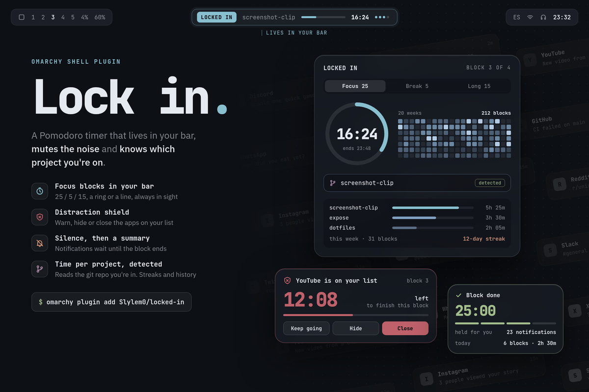

# Locked In for Omarchy

Focus blocks in your Omarchy bar. A Pomodoro timer that silences your
notifications while you work, stops you from drifting into YouTube or Discord,
and knows which project you're on without asking.

*[Español más abajo](#español)*



## Why

A timer in a terminal or a browser tab is easy to ignore, and it has no idea
what you're working on. Locked In lives where you already look, in the bar,
and keeps the rest of the desktop quiet while a block runs.

## How it works

1. **Start a block.** Right-click the widget, or open the dashboard and press
   Start. The project is already filled in: Locked In looks at the git repo of
   the terminal or editor in front of you.
2. **The centre of the bar grows into an island** with the block, the project
   and the time left, then settles back. Do-not-disturb is on until the block
   ends.
3. **Open something on your list** (YouTube in any browser, Discord, Steam…)
   and the island turns into a shield: keep going, hide the window until the
   block ends, or close it. You choose the default.
4. **When the block ends**, the island shows what you did, your streak and the
   notifications that arrived while you were focused. The break starts; fold
   it into a thin island if you want your screen back.
5. **The dashboard** keeps twenty weeks of focus as a heatmap and your time per
   project this week.

Everything follows your Omarchy theme and works under the stock bar or a
third-party one.

## Install

```bash
omarchy plugin add https://github.com/Slylem0/omarchy-locked-in
omarchy plugin enable slylem0.locked-in
```

Enabling places the widget on the right of the bar. Move it with
`omarchy bar move slylem0.locked-in --section left`.

## Remove

```bash
omarchy plugin remove slylem0.locked-in
```

If a block is running, Locked In turns do-not-disturb back to how it was and
returns any hidden windows before it goes. Your history stays in
`~/.local/state/locked-in/`; delete that folder to remove it too:

```bash
rm -rf ~/.local/state/locked-in
```

## Settings

From the widget's settings, or inline in its `shell.json` entry:

| Setting | Default | |
|---|---|---|
| `language` | `auto` | `auto` follows the system locale; `en` or `es` |
| `style` | `line` | `line` shows project, progress and time; `ring` a small ring and time |
| `focusMinutes` | `25` | Focus block length (5–120) |
| `shortBreakMinutes` | `5` | Break after each block (1–30) |
| `longBreakMinutes` | `15` | Longer break (5–60) |
| `longBreakEvery` | `4` | Blocks before a long break (2–8) |
| `autoStartBreaks` | `true` | Start the break when a block ends |
| `autoStartFocus` | `false` | Start the next block when a break ends |
| `silenceNotifications` | `true` | Do-not-disturb during blocks, then a summary |
| `distractionAction` | `warn` | `warn`, `hide`, `close` or `off` |
| `blocklist` | `youtube, discord, steam, reddit, x.com, instagram, twitch` | Words matched against window classes and titles |
| `islandPosition` | `bar` | `bar` grows over the bar; `below` shows it under the bar |

## Keyboard

Locked In doesn't bind keys by itself, so it never takes one you use. Add your
own in `~/.config/hypr/bindings.lua`:

```lua
o.bind("SUPER + ALT + P", "Locked In", "omarchy-shell slylem0.locked-in toggle")
o.bind("SUPER + ALT + SHIFT + P", "Locked In dashboard", "omarchy-shell slylem0.locked-in panel")
```

In the dashboard: Space starts or pauses, `s` skips, `r` stops, `p` edits the
project, Esc closes. Esc also folds the island.

Scroll over the dashboard's ring to change time, 5 minutes per notch. With a
block running it stretches or shortens that block (never below a minute);
otherwise it sets how long your blocks are.

## Command line

`bin/locked-in` drives the timer and reads your history:

```
locked-in start [project]        start a focus block
locked-in pause|resume|toggle    pause or resume the current phase
locked-in skip|stop              skip to the next phase, or stop
locked-in adjust MINUTES         lengthen (+) or shorten (-) the current phase
locked-in status                 current state as JSON
locked-in panel                  open the dashboard
locked-in project                the project in the focused window
locked-in stats [--week|--month] focus time per project
```

```
$ locked-in stats
 screenshot-clip  ██████████████  5h 25m
 expose           ████████░░░░░░  3h 30m
 dotfiles         █████░░░░░░░░░  2h 05m

 Last 7 days: 26 blocks · 11h 00m · streak 12 days
```

Your history is a plain JSON-lines file in
`~/.local/state/locked-in/history.jsonl`, one block per line. The folder and
its files are readable only by you.

## Requirements

Omarchy 4 with its shell. Uses `hyprctl`, `jq` and `git`, which Omarchy
already ships.

## Tests

```bash
test/run
```

Runs the command line against a stubbed shell, Hyprland and `/proc`, so it
never touches your real notifications or windows; then the `Model.js` tests
under node (timer, history, streaks across daylight saving changes, the
blocklist), and validates the manifest.

---

## Español

Bloques de concentración en tu barra de Omarchy. Un Pomodoro que silencia las
notificaciones mientras trabajas, te frena cuando abres YouTube o Discord, y
sabe en qué proyecto estás sin preguntarte.

1. **Empieza un bloque** con clic derecho en el widget, o desde el panel. El
   proyecto ya viene puesto: Locked In mira el repo de git de la terminal o el
   editor que tienes delante.
2. **El centro de la barra crece como una isla** con el bloque, el proyecto y
   el tiempo, y vuelve a su sitio. No molestar queda activado hasta que
   termines.
3. **Si abres algo de tu lista** (YouTube en cualquier navegador, Discord,
   Steam…), la isla se vuelve un escudo: seguir igual, esconder la ventana hasta
   el final del bloque o cerrarla.
4. **Al terminar**, la isla te muestra lo que hiciste, tu racha y los avisos
   que llegaron mientras estabas en foco. Empieza la pausa; puedes minimizarla
   a una isla delgada.
5. **El panel** guarda veinte semanas de foco como mapa de calor y el tiempo por
   proyecto de la semana. Con la rueda del mouse sobre el reloj cambias el
   tiempo de 5 en 5 minutos: alarga o acorta el bloque en curso, o fija la
   duración de tus bloques si no hay ninguno corriendo.

Instálalo con los comandos de *Install* y elige el idioma en los ajustes del
widget (`language: es`). Para desinstalarlo usa
`omarchy plugin remove slylem0.locked-in`; tu historial queda en
`~/.local/state/locked-in/` por si quieres borrarlo también. Todo sigue el tema de Omarchy y funciona con la barra
estándar o con barras de terceros.

## License

MIT
